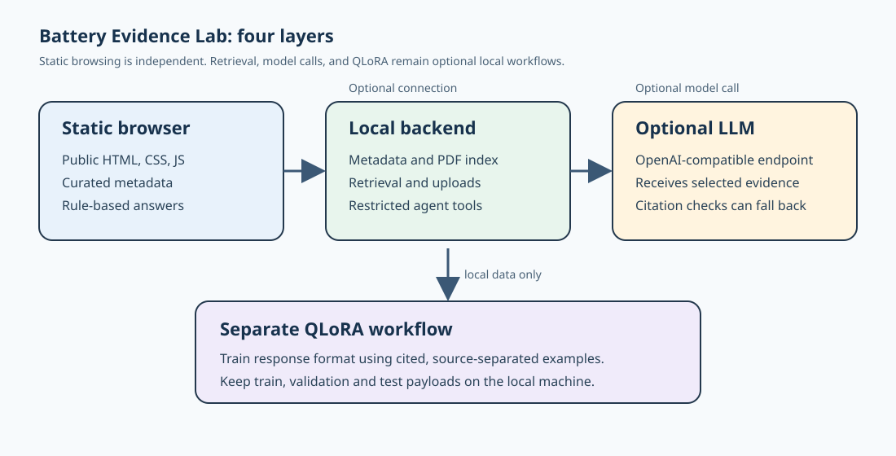

# Evidence-constrained RAG setup

RAG is an optional local retrieval workflow. It searches the local catalogue and locally indexed PDFs, then sends selected metadata and short excerpts to the configured model endpoint. Static pages and deterministic rule-based answers do not require RAG.



## How an answer is produced

1. The local service searches tags, synonyms, and weighted metadata fields.
2. It searches the index built from locally obtained PDFs and selects short page-linked excerpts.
3. Only the selected metadata and excerpts are supplied to the model, if a model endpoint is configured.
4. The model must cite sources as `[P1]`, `[P2]`, and so on. The program checks citation identifiers and falls back to the deterministic answer when a citation is missing or unknown.

The PDF files themselves are not sent as files to the model. If a remote endpoint is configured, selected metadata, evidence, and excerpts leave the computer. Do not send confidential manuscripts, unpublished data, or restricted text to an untrusted service.

## Start with the batch file

Double-click `start-rag.bat`. Enter, in order:

1. The complete OpenAI-compatible `chat-completions` URL.
2. The model name.
3. The API key. Press Enter when a local model does not require one.

A local compatible service may use an address such as:

```text
http://127.0.0.1:11434/v1/chat/completions
```

Use the exact model name and complete endpoint exposed by the installed service. Do not enter only a provider's website URL.

## Start from PowerShell

These variables are temporary to the current PowerShell session:

```powershell
$env:BATTERY_AGENT_LLM_ENDPOINT = "complete chat-completions URL"
$env:BATTERY_AGENT_LLM_MODEL = "model name"
$env:BATTERY_AGENT_LLM_API_KEY = "key for this session"
.\start.ps1
```

Close the PowerShell window after use, or remove the three variables explicitly. The key is not written to a file or Git by this setup.

## Local-data boundary

RAG does not run VASP, Materials Studio, or MD. It organizes and summarizes evidence that is already available to the local service. A valid citation identifier does not make every sentence scientifically correct. Check important parameters and interpretations against the cited page and target system.

GitHub Pages has no API key and does not call a model directly. RAG runs only in the local backend or in a controlled tunnel to that backend. The backend's upload and indexing paths remain within the local or explicitly shared scope.

Citation validation checks whether identifiers exist and can fall back for some unsupported numeric claims. It does not replace sentence-level scientific review.

For temporary access by another person, follow the [sharing guide](SHARING_GUIDE.md). For the static/local/optional-model distinction, see the [README](README.md).
