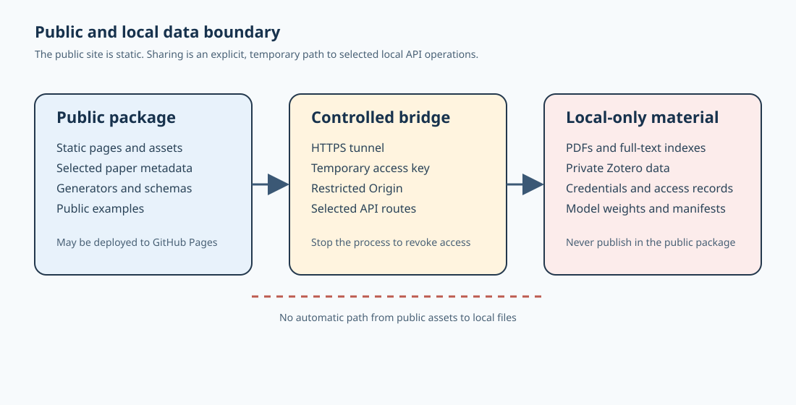

# Sharing the public site and a local research service

The public site is static. Uploads, local full-text retrieval, keyword extraction, and optional model calls require a backend running on your computer. The backend can be exposed temporarily through an HTTPS tunnel.



## Two separate parts

```text
Visitor browser
├─ fixed URL ───────────────> GitHub Pages
│                              HTML/CSS/JS and selected public metadata
└─ temporary key + HTTPS ──> tunnel ──> 127.0.0.1:8765
                                             ├─ PDF upload
                                             ├─ full-text and keyword index
                                             └─ local research answers
```

GitHub Pages cannot run Python. It is suitable for a fixed public entry point. The tunnel is needed only when a browser must call the service on your computer.

Fixed website: <https://rua-creeper-233.github.io/battery-evidence-lab/>

## Scenario 1: browse only

Send the fixed website URL. Your computer may be offline and visitors can still view the selected public metadata, DOI/WOS links, and static rule-based answers.

This mode cannot upload papers, read newly added private literature, or use local full-text retrieval.

## Scenario 2: temporary upload and local retrieval

Double-click `start-share.bat`, or run the sharing script from the repository root. Keep the terminal open for the whole session.

### First-time setup

Install the Python dependencies:

```powershell
python -m pip install -r requirements.txt
```

Install Cloudflare Tunnel:

```powershell
winget install --id Cloudflare.cloudflared
```

Close and reopen PowerShell so that `cloudflared` is on the command search path.

### Each sharing session

1. Run:

   ```powershell
   .\start-share.ps1
   ```

   If PowerShell blocks script execution, use:

   ```powershell
   powershell -NoProfile -ExecutionPolicy Bypass -File .\start-share.ps1
   ```

2. Copy the temporary access key shown in the terminal and wait for an address such as `https://random-name.trycloudflare.com`.
3. Open the fixed GitHub Pages site and select **Upload literature**.
4. Enter the tunnel address and temporary key, then select **Test connection**.
5. Select a PDF. Title, DOI, year, journal, and authors can be entered manually or left for the program to identify.
6. Send the fixed site, the current tunnel address, and the current key through a trusted channel.
7. Press `Ctrl+C` in the sharing terminal when finished. The tunnel, local service, and key then stop working together.

The computer must stay powered on and connected, and the sharing terminal must remain open. A Quick Tunnel address changes each time it starts. It is suitable for a demonstration, group meeting, or short collaboration, not an unattended permanent service.

## Security boundary

- Cross-origin requests allow only `https://rua-creeper-233.github.io`.
- Remote API requests must include the current random access key.
- The key is not written to Git and stays in the current browser tab.
- Remote users do not receive Zotero item keys or attachment keys.
- Remote users cannot download or open PDFs stored on your computer through this interface.
- Uploaded PDFs and new metadata stay in Git-ignored local paths and are not deployed to GitHub Pages.
- A single uploaded file is limited to 50 MiB. An existing different PDF is not silently overwritten.

Send the access key only to trusted visitors or group members, and stop the sharing process when it is no longer needed.

## Scenario 3: a stable backend address

The fixed GitHub Pages URL can remain unchanged. Only the API address changes. For a stable address:

1. Use a domain whose DNS is managed by Cloudflare.
2. Create a named Cloudflare Tunnel.
3. Route a hostname such as `battery-api.example.com` to `http://127.0.0.1:8765`.
4. Run `cloudflared` as a Windows service.
5. Add Cloudflare Access, or retain this project's access key.
6. Keep the computer online for as long as the service is needed.

Without a domain, use a Quick Tunnel. Do not bind the Python service to a public network interface or expose port 8765 directly on a router.

## API endpoints

- `GET /api/health`: service status.
- `GET /api/capabilities`: upload limits, keyword API version, and privacy policy.
- `POST /api/upload`: `multipart/form-data` PDF upload.
- `POST /api/keywords`: send `text` or `paper_id` and receive versioned keywords.
- `POST /api/chat`: local full-text retrieval and answer generation.

The keyword interface is currently `v1`, provided by `builtin-domain-frequency`. A later backend can replace it with KeyBERT, an LLM, or a materials-science model without changing the web request path.

## Official references

- [GitHub Pages: What is GitHub Pages?](https://docs.github.com/en/pages/getting-started-with-github-pages/what-is-github-pages)
- [Cloudflare Quick Tunnels](https://developers.cloudflare.com/cloudflare-one/networks/connectors/cloudflare-tunnel/do-more-with-tunnels/trycloudflare/)
- [Cloudflare Tunnel setup](https://developers.cloudflare.com/tunnel/setup/)
